<picture><source media="(prefers-color-scheme: dark)" srcset="assets/header.svg"></picture>

I build full-stack web apps, and I like projects that solve a concrete problem for someone: running a hostel, finding a place to rent, supporting mental health. I'm early in my career and learn mostly by shipping.

## Selected work

<a href="https://github.com/Magical004/pg-erp"><picture><source media="(prefers-color-scheme: dark)" srcset="assets/card-pg-erp.svg"></picture></a>
<a href="https://github.com/Magical004/ai-mental-health"><picture><source media="(prefers-color-scheme: dark)" srcset="assets/card-ai-mental-health.svg"></picture></a>
<a href="https://github.com/Magical004/WEB"><picture><source media="(prefers-color-scheme: dark)" srcset="assets/card-WEB.svg"></picture></a>
<a href="https://github.com/Magical004/Game"><picture><source media="(prefers-color-scheme: dark)" srcset="assets/card-Game.svg"></picture></a>
<a href="https://github.com/Magical004/Home-Renting"><picture><source media="(prefers-color-scheme: dark)" srcset="assets/card-Home-Renting.svg"></picture></a>
<a href="https://github.com/Magical004/Crop-Diseases"><picture><source media="(prefers-color-scheme: dark)" srcset="assets/card-Crop-Diseases.svg"></picture></a>

Also: <a href="https://github.com/Magical004/EthnusMern_Internship_tasks">Ethnus MERN internship tasks</a> · <a href="https://github.com/Magical004?tab=repositories">all repositories →</a>

## Stack

JavaScript, TypeScript, Python, React, Node.js, Tailwind CSS, Vite, SQLite, Git, Playwright.

## Activity

<picture><source media="(prefers-color-scheme: dark)" srcset="https://raw.githubusercontent.com/Magical004/Magical004/output/activity-dark.svg"></picture>

<picture><source media="(prefers-color-scheme: dark)" srcset="https://raw.githubusercontent.com/Magical004/Magical004/output/github-snake-dark.svg"></picture>

## Find me

[github.com/Magical004](https://github.com/Magical004)
