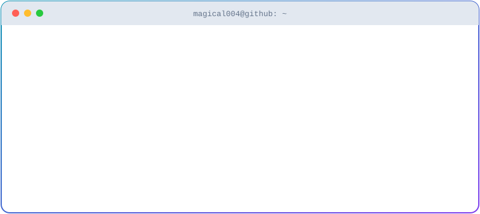
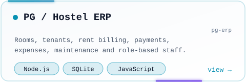
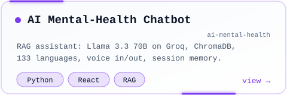
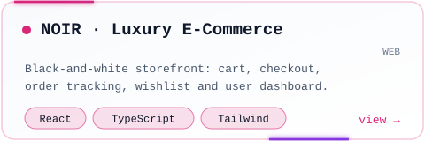
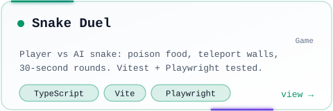
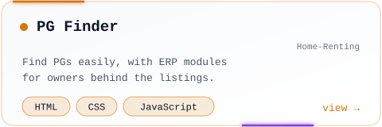
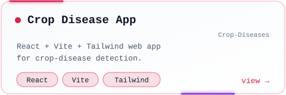

<picture><source media="(prefers-color-scheme: dark)" srcset="assets/header.svg"></picture>

 

<picture><source media="(prefers-color-scheme: dark)" srcset="assets/divider.svg"></picture>

<picture><source media="(prefers-color-scheme: dark)" srcset="assets/h-about.svg"></picture>

<picture><source media="(prefers-color-scheme: dark)" srcset="assets/terminal.svg"></picture>

  

<picture><source media="(prefers-color-scheme: dark)" srcset="assets/h-stack.svg"></picture>

<picture><source media="(prefers-color-scheme: dark)" srcset="assets/marquee.svg"></picture>

<picture><source media="(prefers-color-scheme: dark)" srcset="assets/divider.svg"></picture>

<picture><source media="(prefers-color-scheme: dark)" srcset="assets/h-projects.svg"></picture>

<a href="https://github.com/Magical004/pg-erp"><picture><source media="(prefers-color-scheme: dark)" srcset="assets/card-pg-erp.svg"></picture></a>
<a href="https://github.com/Magical004/ai-mental-health"><picture><source media="(prefers-color-scheme: dark)" srcset="assets/card-ai-mental-health.svg"></picture></a>
<a href="https://github.com/Magical004/WEB"><picture><source media="(prefers-color-scheme: dark)" srcset="assets/card-WEB.svg"></picture></a>
<a href="https://github.com/Magical004/Game"><picture><source media="(prefers-color-scheme: dark)" srcset="assets/card-Game.svg"></picture></a>
<a href="https://github.com/Magical004/Home-Renting"><picture><source media="(prefers-color-scheme: dark)" srcset="assets/card-Home-Renting.svg"></picture></a>
<a href="https://github.com/Magical004/Crop-Diseases"><picture><source media="(prefers-color-scheme: dark)" srcset="assets/card-Crop-Diseases.svg"></picture></a>

Also: <a href="https://github.com/Magical004/EthnusMern_Internship_tasks">Ethnus MERN internship tasks</a> · <a href="https://github.com/Magical004?tab=repositories">all repositories →</a>

<picture><source media="(prefers-color-scheme: dark)" srcset="assets/divider.svg"></picture>

<picture><source media="(prefers-color-scheme: dark)" srcset="assets/h-activity.svg"></picture>

<picture><source media="(prefers-color-scheme: dark)" srcset="https://raw.githubusercontent.com/Magical004/Magical004/output/github-snake-dark.svg"></picture>

 

<picture><source media="(prefers-color-scheme: dark)" srcset="https://github-readme-activity-graph.vercel.app/graph?username=Magical004&bg_color=0d1117&color=22d3ee&line=8b5cf6&point=ffffff&area=true&area_color=8b5cf6&hide_border=true"></picture>

<picture><source media="(prefers-color-scheme: dark)" srcset="assets/divider.svg"></picture>

<picture><source media="(prefers-color-scheme: dark)" srcset="assets/h-connect.svg"></picture>

 

<code>while (alive) { learn(); build(); improve(); }</code>

<picture><source media="(prefers-color-scheme: dark)" srcset="assets/footer.svg"></picture>

