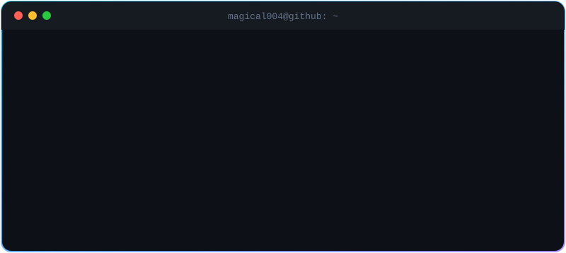
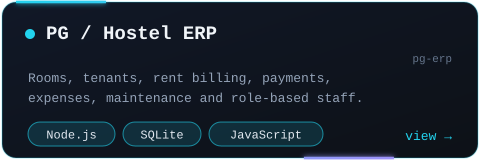
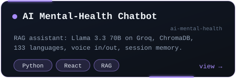
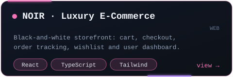
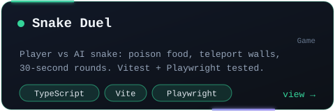
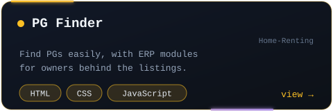
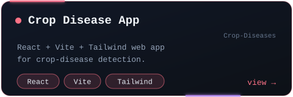

 

  

Also: <a href="https://github.com/Magical004/EthnusMern_Internship_tasks">Ethnus MERN internship tasks</a> · <a href="https://github.com/Magical004?tab=repositories">all repositories →</a>

 

 

<code>while (alive) { learn(); build(); improve(); }</code>

